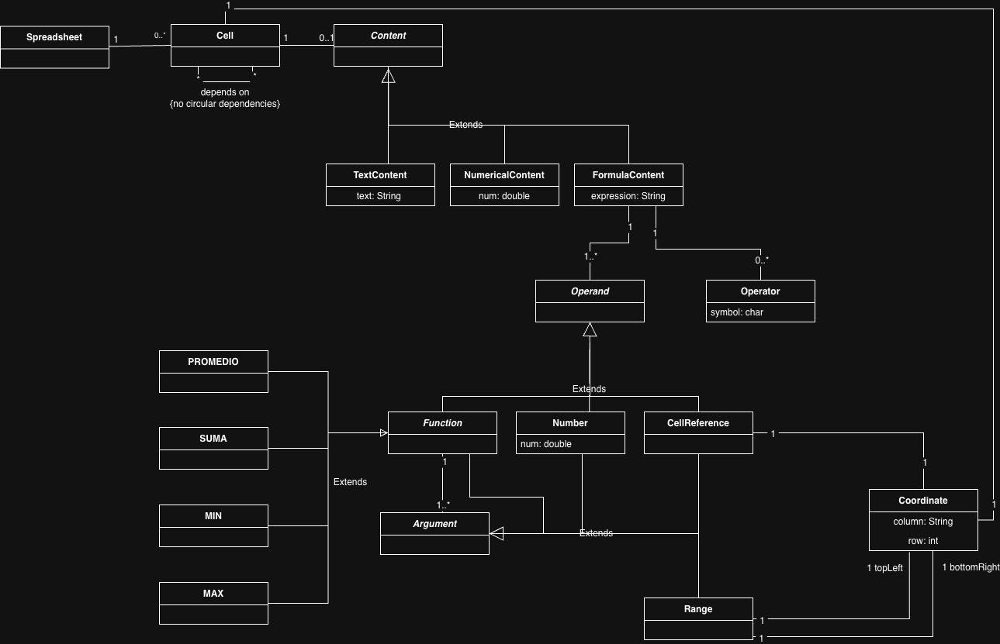
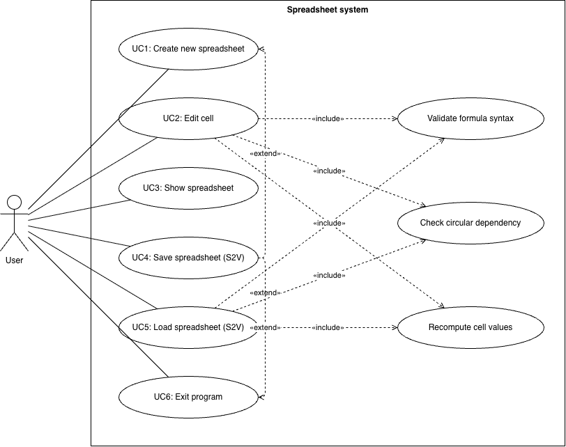

# softeng-final

Software Engineering (UPC) final project: a console-based spreadsheet.

## Deliverable 1: Analysis

### Domain model

Source: [`Deliverable1.drawio`](Deliverable1.drawio)

### Use cases

Actor: **User**

| # | Use case | Notes |
|---|---|---|
| UC1 | Create new spreadsheet | |
| UC2 | Edit cell (number / text / formula) | Error flows: invalid coordinate, formula syntax error, circular dependency, text not convertible to number |
| UC3 | Show spreadsheet | Contents and computed values |
| UC4 | Save spreadsheet to S2V file | Error flow: file can't be written |
| UC5 | Load spreadsheet from S2V file | Error flow: file not found / invalid S2V |
| UC6 | Exit program | |

Full descriptions (preconditions, main flows, error flows, postconditions): [`use-cases.md`](use-cases.md)

### Use case diagram

Source: [`useCaseDiagram.drawio`](useCaseDiagram.drawio)