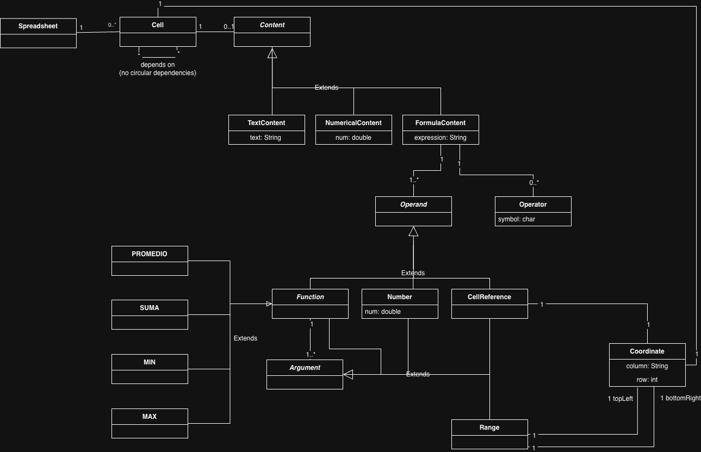
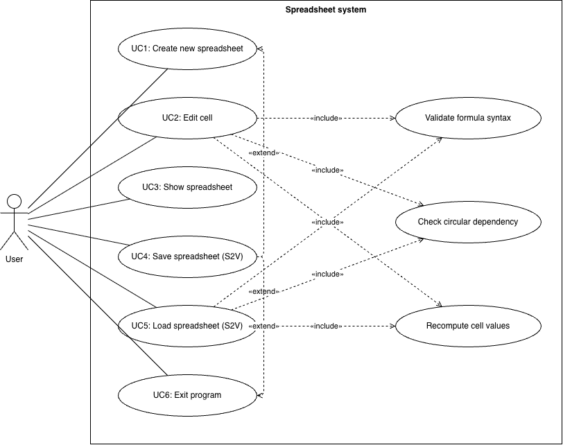

# softeng-final

Software Engineering (UPC) final project: a console-based spreadsheet.

## Deliverable 1: Analysis

### Domain model



Source: [`Deliverable1.drawio`](docs/Deliverable1.drawio)

### Use cases

Actor: **User**

| # | Use case | Notes |
|---|---|---|
| UC1 | Create new spreadsheet | |
| UC2 | Edit cell (number / text / formula) | Error flows: invalid coordinate, formula syntax error, circular dependency, text not convertible to number |
| UC3 | Show spreadsheet | Contents and computed values |
| UC4 | Save spreadsheet to S2V file | Error flow: file can't be written |
| UC5 | Load spreadsheet from S2V file | Error flow: file not found / invalid S2V |
| UC6 | Exit program | |

Full descriptions (preconditions, main flows, error flows, postconditions): [`docs/useCases.md`](docs/useCases.md)

### Use case diagram



Source: [`useCaseDiagram.drawio`](docs/useCaseDiagram.drawio)

## Deliverable 2: Domain model implementation + load/save

Due Wed 25 Nov 23:59. Scope: the Java classes for the domain model, plus loading and saving spreadsheets (S2V) and setting/viewing cell **content**. No formula evaluation yet.

### Project structure

```
src/
├── spreadsheet/
│   ├── Spreadsheet, Cell, Coordinate
│   ├── content/        Content, NumericalContent, TextContent, FormulaContent
│   ├── formula/        Operand, Argument, Operator, Range
│   │   ├── operands/   NumericValue, CellReference, Function
│   │   └── functions/  Suma, Min, Max, Promedio
│   └── io/             S2VStorage
├── ui/                 ConsoleMenu (text menu)
├── example/            professor's expression-parser example (used from step 5)
test/
└── spreadsheet/        unit tests, same packages as src/
lib/                    expression-factory.jar + JUnit 5.7
docs/                   Deliverable 1 diagrams, use cases, testing SOP
```

### Step 1: spreadsheet data structure ✅

Stores numbers, text and formulas in cells, without calculating anything.

| Class | Responsibility |
|---|---|
| `Coordinate` | Cell address (column letters + row number). Parses `"AB12"`, converts columns `A`=1 … `Z`=26, `AA`=27 |
| `Content` | Abstract cell content. `Content.fromText` decides the type: starts with `=` → formula, a valid number → number, otherwise text |
| `NumericalContent`, `TextContent`, `FormulaContent` | The three content types. `FormulaContent` keeps only the expression text for now |
| `Cell` | A coordinate plus its content (empty when there is none) |
| `Spreadsheet` | The non-empty cells, stored in a `Map<Coordinate, Cell>`. `setContent("C3", "=A1+B1")`, `getContentText("C3")` |
| `formula/…` | The formula pieces from the domain model, as empty shells to be filled in from step 3 |

**Design notes**
- Cells are stored in a **map**, not a 2D array: the grid has no fixed size (columns go A…Z, AA, …) and most cells are empty.
- `Operand` and `Argument` are **interfaces**: `NumericValue`, `CellReference` and `Function` are both in the domain model, and a Java class can only extend one class.

**Tests:** `test/spreadsheet/SpreadsheetTest.java` (coordinates, content types, setting and viewing content).

### Step 2: load and save spreadsheets (S2V) ✅

Reads and writes spreadsheets in S2V format, and adds a text menu to set and view cell content.

| Class | Responsibility |
|---|---|
| `S2VStorage` | `save(sheet, path)` and `load(path)`. One line per row, cells separated by `;`, empty cells left empty, each row ending at its last non-empty cell. Inside formulas, the `;` between function arguments is stored as `,` and converted back on load |
| `ConsoleMenu` | Text menu for the use cases: create, edit cell, show, save, load, exit. Shows cell **content** (e.g. `=A1+B1`), not values |

Example: the PDF's sample spreadsheet saves as

```
=C1+C2;4;1
;;2
;TOTAL;=A1+B1
```

**Design notes**
- `ConsoleMenu` only talks to the user; the logic is in `Spreadsheet` and `S2VStorage`, so the console could be replaced by a GUI without touching them (a requirement in the PDF).
- Load builds a new `Spreadsheet` and only replaces the current one if reading succeeds.

**Tests:** `test/spreadsheet/io/S2VStorageTest.java` (saving the PDF example, the `;` ↔ `,` conversion, save → load gives back the same contents).

### How to run

- Tests: right-click `test` → **Run 'All Tests'**.
- The program: run `ui/ConsoleMenu` (green ▶ next to `main`).

See [`docs/testing-sop.md`](docs/testing-sop.md) for how tests are written in this project.
